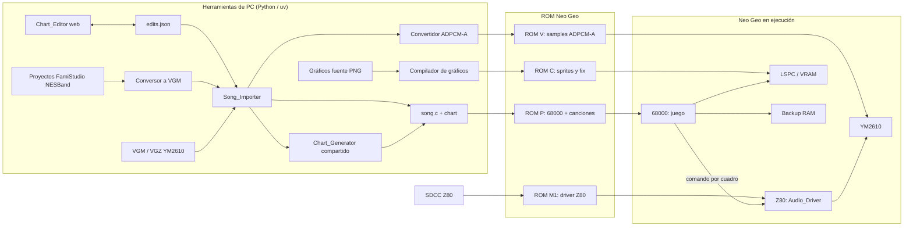
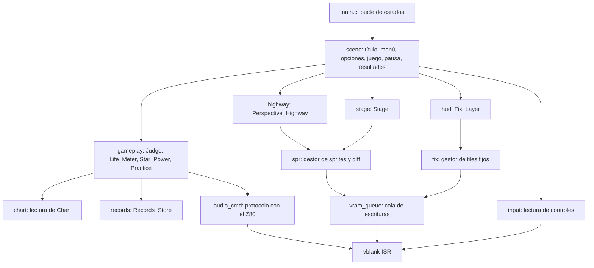
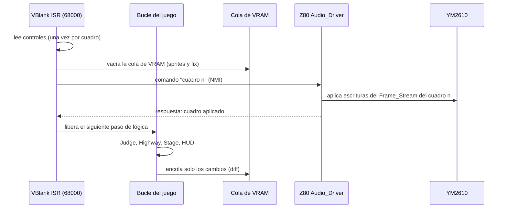

# Documento de Diseño: NGBand (neogeo-band)

## Overview

NGBand es el port a la SNK Neo Geo (cartucho MVS/AES) del juego de ritmo de la familia NESBand, GBBand y GENBand. Este diseño cubre los 20 requisitos de `requirements.md`.

Decisiones principales:

| Decisión | Elección | Razón |
|---|---|---|
| Código del juego | C para el 68000 con `ngdevkit` (GCC m68k) | Igual que GENBand (S3). Ensamblador solo en rutas calientes si hiciera falta. |
| Audio | Driver Z80 propio (SDCC) que consume un Frame_Stream del YM2610 | Mismo modelo de "escrituras de registros por cuadro" que GENBand (S4). |
| Perspectiva | Sprites escalados por hardware (shrink H 4 bits, V 8 bits) | La Neo Geo no tiene interrupciones por línea útiles para esto y sí escala sprites (R5). |
| HUD | Fix_Layer (tiles 8x8) | Capa fija, sin costo de sprites (R5.9). |
| Gráficos | Precompilados en `build.sh` con herramientas de PC | Evita el arranque lento de GENBand (R1.9, P5). |
| Batería | ADPCM-A (6 canales) con samples en la ROM `V` | Más natural en el YM2610 (R13, P2). |
| Récords | Backup RAM del MVS, con firma y suma de comprobación | R9, S7. |
| Herramientas de PC | Python con `uv`, comando `ngband` | Mismo flujo que GENBand. |
| Pruebas | `pytest` para la lógica de PC y MAME + Lua para la ROM | R17. |

### Investigación y hallazgos que informan el diseño

Los datos de hardware salen de conocimiento estándar de la plataforma Neo Geo (wiki de Neo Geo Development) y de la documentación de `ngdevkit`. Quedan por verificar contra el hardware/MAME durante la fase 1:

- **Sprites:** hay 381 sprites, cada uno una columna de hasta 32 tiles de 16x16. Se controlan con cuatro bloques de VRAM: SCB1 (tiles y atributos), SCB2 (escala: 4 bits horizontal, 8 bits vertical), SCB3 (posición Y, altura y bit "sticky") y SCB4 (posición X). El hardware dibuja como máximo 96 sprites por línea de barrido, límite que R5.6 hace explícito.
- **Escala:** la reducción horizontal tiene 16 niveles y la vertical 256, con valor máximo igual al tamaño completo. R5.3 pide al menos 7 niveles de tamaño de gema, que cabe en los 16 horizontales.
- **Escritura de VRAM:** se hace por los puertos `REG_VRAMADDR`, `REG_VRAMRW` y `REG_VRAMMOD`, con autoincremento. El 68000 debe escribirla durante el blanqueo vertical para evitar artefactos (R5.7).
- **Fix_Layer:** rejilla de 40x32 tiles de 8x8, con 16 paletas.
- **Sonido:** el Z80 recibe comandos del 68000 por el registro de comando (que dispara una NMI) y responde por el registro de respuesta. El YM2610 se maneja por sus puertos A y B. ADPCM-A tiene 6 canales con atenuación por canal y ADPCM-B uno. Los samples viven en las ROM `V`.
- **Backup RAM:** 64 KB en el MVS, accesible solo con el desbloqueo `REG_SRAMUNLOCK`. Se bloquea de nuevo al terminar de escribir.
- **Sincronía:** el handler de VBlank del 68000 manda un comando de "cuadro" al Z80. Con una escritura por cuadro y NMI se obtiene el mismo contrato que el `Frame_Stream` de GENBand.

## Architecture

### Vista general



### Capas del 68000



### Flujo de un cuadro



Decisiones de diseño:

- **Un paso por cuadro (R2.10, R6.5):** la lógica corre en el bucle principal, que espera la bandera de VBlank. Los controles se leen una vez en el ISR y se entregan a la lógica como máscara de botones.
- **Cola de VRAM con diff (R5.7, R18.3):** la lógica nunca escribe VRAM directo. Compara el estado nuevo con el cuadro anterior (shadow) y encola solo las diferencias. El ISR vacía la cola dentro del blanqueo.
- **El Z80 posee el Frame_Stream (R12.1, R12.2):** el 68000 solo envía el número de cuadro. El stream de la canción está en la ROM de programa y el Z80 lo lee desde su ventana de banco. Alternativa descartada: que el 68000 empuje cada escritura de registro; saturaría el canal de comandos de un solo byte.
- **Cuadros de la canción independientes de VELOCIDAD (R8.3, R12.8):** un acumulador de "pasos por cada 4 cuadros" decide si el cuadro de juego avanza el Chart y el stream. Si no avanza, el 68000 manda el comando "mantener" y el Z80 no consume escrituras.

## Components and Interfaces

### 1. Build_System (`build.sh`) — R1

Orquesta, en orden: generación de gráficos (`ngband gfx`), conversión de samples (`ngband adpcm`), compilación del Z80 con SDCC, compilación del 68000 con GCC y empaquetado (`.neo`/ROMs MAME). Emite `build/ngband.*` y `build/ngband.sym`.

- `--release`: falla si `git status --porcelain src/ audio/` no está vacío (R1.4), copia a `build/release/ngband-v<VERSION>.*`, calcula `.sha256`, agrega la licencia y excluye `src/songs/` marcadas como comerciales (R1.7).
- Reproducibilidad (R1.5): sin marcas de tiempo, rutas absolutas ni orden de directorio no determinista. Las canciones se ordenan alfabéticamente (R1.8). Se compila con `SOURCE_DATE_EPOCH` fijo.
- La versión se lee de `VERSION` y se inyecta como `NGBAND_VERSION` para la pantalla de título (R1.6).

### 2. Judge y reglas del núcleo (`gameplay.c`) — R2, R3, R4

API pura, sin acceso a hardware, para poder probarla en PC (la misma fuente C se compila para host en `tests/host/`).

```c
typedef struct {
  u8  lanes;            /* 3, 4 o 5 según Difficulty */
  u16 combo, max_combo;
  u8  multiplier;       /* 1..4 */
  s16 life;             /* 0..LIFE_MAX */
  u32 score;
  u32 score_base;       /* sin Star_Power ni Sustain, para estrellas */
  u8  star_bar;         /* 0..100 */
  bool star_active, muted, failed;
} JudgeState;

typedef struct { u8 pressed, edge; } PadInput; /* máscara de 5 carriles */

void judge_step(JudgeState*, const Chart*, ChartCursor*, PadInput, u16 frame);
u8   judge_multiplier(u16 combo);
u8   judge_stars(u32 score_base, u32 perfect);
```

Reglas clave: ventana de ±6 cuadros (R2.2), 50 puntos × Multiplier (R2.3), un acorde cuenta una Note por botón (R2.4), Multiplier 1/2/3/4 en combo 0/10/20/30 (R2.5), golpe al aire y Note perdida rompen combo y silencian (R2.6, R2.7), Sustain 10 puntos cada 8 cuadros (R2.8), umbrales de estrellas 20/40/60/80/95 (R2.9). Vida +1 por acierto, −2 por pérdida (−1 en fácil), −1 por golpe al aire (R3.1–R3.3).

### 3. Perspective_Highway (`highway.c`) — R5

Tabla de perspectiva precalculada en tiempo de compilación por `ngband gfx`:

```c
typedef struct {
  u16 y;           /* posición Y en pantalla */
  u8  hshrink;     /* 0..15 (15 = tamaño completo) */
  u8  vshrink;     /* 0..255 */
  s16 x_lane[5];   /* X central de cada carril a esa profundidad */
} PerspRow;

extern const PerspRow persp[PERSP_ROWS];
```

- La profundidad `d` de una Note es `(frame_nota - frame_actual)` convertido a filas por la velocidad de caída (6, 5, 4, 3 cuadros por 8 px, R5.8). `d` indexa `persp[]`.
- La gema se agrupa en `GEM_LEVELS ≥ 7` niveles de tamaño (R5.3), cada uno con su tile de arte; el nivel decide el `hshrink` y el `vshrink` base.
- Colas de Sustain (R5.4): una pila de sprites con `vshrink` ajustado al tramo y `hshrink` al ancho de esa profundidad. Las líneas de tiempo (R5.5) son sprites de una fila escalados con el mismo `persp[]`.
- **Presupuesto de sprites por línea (R5.6):** con 5 carriles y 2 jugadores, el diseño reserva ≤ 96 sprites por línea. El `highway` lleva un contador por banda de líneas durante `highway_build()` y descarta primero las líneas de tiempo, después las colas lejanas, antes de exceder el límite. Es una función pura de la lista de sprites, por lo que se prueba en PC.
- **Manejo de sprites:** un `SpritePool` asigna índices fijos por clase (gemas, colas, líneas, escenario). Cada cuadro se arma `SpriteShadow[381]` y se compara con el cuadro anterior; solo los cambios pasan a la cola de VRAM (R18.3).
- **2 jugadores (R5.10):** dos instancias con `x_origin` en cada mitad. El presupuesto de sprites se divide entre las dos.
- **Modificadores:** ESPEJO invierte `lane -> lanes-1-lane` al leer el Chart, salvo batería (R8.2). CAIDA DE NOTAS reemplaza la velocidad de la Difficulty (R8.4).

### 4. Fix_Layer y HUD (`hud.c`, `fix.c`) — R5.9, R7

`FixShadow[40*32]` guarda el mapa deseado y el último enviado. `fix_flush()` encola solo los tiles distintos. Los textos usan la fuente *Bongo-8 Mono* convertida a tiles 8x8 por `ngband gfx`. Todo el texto está en español (R7.8). El HUD dibuja puntaje, combo, multiplicador, medidor de vida y de Star_Power.

### 5. Stage (`stage.c`) — R11

Máquina de estados sin hardware, alimentada por `(combo, star_active, beat_tick, phrase_done, all_failed, players)`:

```c
typedef struct {
  u8 crowd_state;       /* QUIETO | BRAZOS | SALTO */
  u8 light_phase;       /* 0..3 cian, rojo, amarillo, violeta */
  u8 pulse;             /* latido de luces */
  u8 flash, bolt_lane;  /* rayo y destello */
  bool lights_off;
} StageState;

void stage_step(StageState*, const StageInput*);
```

El público y las luces se dibujan con sprites del pool "escenario", que reciben el presupuesto restante tras el Highway. La torre central de 2 jugadores se dibuja entre ambos Highways (R11.8).

### 6. Audio_Driver (Z80, `audio/z80/`) y `audio_cmd` (68000) — R12, R13

**Protocolo 68000 → Z80** (un byte por escritura en el registro de comando; los comandos con argumento se envían como dos bytes consecutivos, comando y argumento, porque no hay RAM compartida entre las dos CPU):

| Comando | Argumento | Efecto |
|---|---|---|
| `CMD_SILENCE_ALL` | — | Silencia todos los canales y reinicia registros (R12.9) |
| `CMD_SONG_START` | índice de canción | Posiciona el stream al cuadro 0 |
| `CMD_SONG_SEEK` | cuarto (0..3) | Salta al punto de práctica (R8.6) |
| `CMD_FRAME` | — | Aplica el cuadro siguiente (R12.1) |
| `CMD_FRAME2` | — | Aplica dos cuadros en un VBlank (velocidad 125%) |
| `CMD_HOLD` | — | No avanza el stream (R12.8) |
| `CMD_PAUSE` / `CMD_RESUME` | — | Detiene y reanuda sin perder el cuadro (R12.7) |
| `CMD_MUTE_INST` | instrumento | Baja al mínimo carriers/atenuación y recuerda el valor (R12.3) |
| `CMD_UNMUTE_INST` | instrumento | Restaura el valor recordado en el mismo cuadro (R12.4) |
| `CMD_SFX` | id de efecto | Menú (mover, aceptar, volver) y 3 efectos de fallo (R12.5) |

**Estado del driver:** una `ShadowRegs[256 x 2 puertos]` guarda lo que la canción pide para cada registro. Al silenciar un instrumento, el driver escribe el valor mínimo en el chip pero **no** en la sombra; al restaurar, copia de la sombra al chip. Lo mismo se aplica a los canales que toma un efecto: al terminar el efecto se reponen desde la sombra (R12.6).

**Batería (R13):** el evento `DRUM(n)` del stream dispara el sample `n` en un canal ADPCM-A libre (round-robin entre los 6). `CMD_MUTE_INST` de batería detiene los canales ADPCM-A de batería hasta el siguiente acierto (R13.4).

**Respuesta Z80 → 68000:** el Z80 devuelve el último cuadro aplicado. El 68000 lo compara en pruebas (modo de depuración) para detectar desincronía.

### 7. Records_Store (`records.c`) — R9

Acceso a la backup RAM con `unlock/lock` alrededor de cada escritura. La tabla en RAM es la fuente de verdad en ejecución; se vuelca a la backup RAM al guardar un récord. Serialización y validación son funciones puras (`records_encode`, `records_decode`) para probarse en PC. Ver el modelo de datos más abajo.

### 8. Song_Importer y herramientas (`pctools/ngband_tools/`) — R13–R15

Módulos de Python:

| Módulo | Responsabilidad |
|---|---|
| `vgm.py` | Lector de `.vgm`/`.vgz`: cabecera, bucle, comandos YM2610 (`0x58`, `0x59`, `0x5A`...), ADPCM-A/B (`0x67` bloque de datos). Informa comandos no soportados (R13.5). |
| `ym2610.py` | Seguimiento de estado de registros, key-on y detección de notas FM por bloque y F-number (R14.6), SSG por periodo. |
| `frames.py` | Agrupa escrituras por cuadro de video (60 Hz), elimina las que repiten valor y codifica el Frame_Stream. |
| `notes.py` | Extracción de notas por canal. Un cambio de más de 3/4 de semitono con la tecla presionada es otra nota (R14.6). |
| `drums.py`, `chart.py` | Chart_Generator compartido con NESBand/GENBand (R2.11, R4.6). |
| `adpcma.py` | Conversión de PCM a ADPCM-A y mapa de samples (R13.2). |
| `songgen.py` | Escribe `song.c`, `import.json` y los datos de Charts. |
| `cli.py` | `channels`, `import-song`, `reimport`, `list-songs`, `edit-chart`, `gfx`, `adpcm`. |
| `famistudio.py` | Conversión de proyectos de NESBand a VGM del YM2610 con parches FM por nombre (R15.2, R15.3). |

### 9. Chart_Editor (`pctools/ngband_tools/editor/`) — R16

Servidor HTTP mínimo en `127.0.0.1` (R16.1) y una página con JavaScript. Escuchar usa un emulador del YM2610 en JavaScript (por ejemplo una compilación WASM/JS de `ymfm` o similar), alimentado con el mismo Frame_Stream que la ROM (R16.6). Las ediciones se guardan como diferencia en `edits.json` (R16.4). El mismo `check_playable` que el generador marca en rojo las Notes inválidas (R16.8).

### 10. Test_Harness — R17

- `tests/run_tests.sh [patrón] [--no-build]`: compila (salvo `--no-build`), lanza MAME sin ventana con un script Lua por caso y guarda capturas, `audio.wav` y registro en `build/test-<nombre>/` (R17.9, R17.11).
- Los scripts Lua inyectan entradas de los Bots y leen la RAM por símbolos de `ngband.sym`.
- `uv run pytest` prueba lector de VGM, extracción de notas, generador, editor y conversión ADPCM-A (R17.10).
- **Bots:** perfecto, nada, machacar y humano (R17.2–R17.4, R17.12).

## Data Models

### Chart (en ROM)

Igual que NESBand: lista de pares `(delta_frames, lanes_mask)` con banderas.

```c
typedef struct {
  u8  delta_lo;        /* cuadros desde la nota anterior, con extensión */
  u8  lanes;           /* bits 0..4 = carriles; bit 5 = estelar; bit 6 = sustain */
} ChartEv;             /* 2 bytes; delta >= 255 usa un evento de extensión */

typedef struct {
  u16 count;
  const ChartEv* ev;
} Chart;

typedef struct {
  u32 title_hash;           /* hash de título + juego, ID del récord (R9.2) */
  const char* title;
  const char* game;
  u16 total_frames;
  u16 beat_frames;
  u32 perfect[4][4];        /* puntaje perfecto por instrumento y dificultad */
  Chart chart[4][4];        /* instrumento x dificultad (12 útiles + batería) */
  const u8* stream;         /* Frame_Stream, en la ventana del Z80 */
  u32 stream_len;
  u8 sample_count;
} Song;
```

### Frame_Stream

Secuencia de cuadros. Cada cuadro es: `count` (1 byte, 0–254; 255 = continuación) seguido de `count` registros `(puerto/registro, valor)`. Los eventos de batería se codifican como un par reservado con registro `0xFE` y valor igual al índice de sample. Un cuadro con `count = 0` es un cuadro vacío. El importador elimina las escrituras que repiten el valor del cuadro anterior.

### Configuración de partida

```c
typedef struct {
  u8 song, instrument[2], difficulty, players;   /* 1 o 2 */
  u8 mode;            /* SOLO | VS | COOP */
  u8 no_fail, mirror, speed_idx, fall_idx, practice, practice_start, fail_fx;
} GameConfig;
```

`is_record_eligible(cfg, result)` es pura: falso si perdió, SIN FALLO o una opción distinta de la normal (salvo `fail_fx`) (R9.5); en VS siempre falso (R10.3); en COOP solo si los dos terminan en pie (R10.8).

### Tabla de récords (Backup RAM)

```c
typedef struct {            /* 12 bytes por entrada */
  u32 title_hash;
  u8  instrument, difficulty;
  u8  stars;
  char initials[3];
  u32 score;
} RecordEntry;

typedef struct {
  char  magic[4];           /* "NGBR" */
  u8    version;
  u8    count;
  RecordEntry e[MAX_RECORDS];
  u16   checksum;           /* suma de comprobación de todo lo anterior */
} RecordTable;
```

Codificación en big endian (orden nativo del 68000). `records_decode` devuelve tabla vacía si `magic` o `checksum` no coinciden (R9.4).

### Tabla de perspectiva

`PerspRow` como arriba, generada por una función de `gfx` a partir de: horizonte `y_h`, línea de golpe `y_g`, anchos `w_h` y `w_g`. La profundidad `z` relaciona `y` con escala `s = z_h / z`; `hshrink = round(15 * s)` y `vshrink = round(255 * s)`.

### Metadatos de importación (`import.json`)

```json
{ "source": "ruta.vgm", "name": "cancion", "title": "...", "game": "...",
  "duration": 120, "guitarra": "fm1", "teclado": "fm2", "bajo": "fm3",
  "bateria": "adpcma", "beat_frames": 36 }
```

### `edits.json`

Lista de operaciones sobre el chart automático, cada una identificada por `(instrumento, dificultad, cuadro, carril)`: `add`, `move`, `delete`, `set_flags`. Al reimportar, una operación cuyo objetivo no existe se omite con aviso (R16.5).


## Correctness Properties

*A property is a characteristic or behavior that should hold true across all valid executions of a system-essentially, a formal statement about what the system should do. Properties serve as the bridge between human-readable specifications and machine-verifiable correctness guarantees.*

Alcance: las propiedades cubren la lógica pura (Judge, reglas de modos, tablas de perspectiva, récords, importador, generador, editor y el modelo de sombra del driver de audio). Lo que depende de hardware (VBlank, VRAM, Z80 real, backup RAM física, rendimiento) se prueba con pruebas de integración en MAME, no con propiedades. La lógica en C se compila también para el host (`tests/host/`) y se prueba con la misma fuente que va en la ROM.

Reflexión: se consolidaron los criterios 2.3 y 2.5 (puntaje y multiplicador), 3.1 a 3.4 (vida), 3.8, 3.9 y 12.7 (pausa), 8.3 y 12.8 (velocidad), 9.6 y 9.7 (round trip de récords), 12.3, 12.4 y 12.6 (modelo de sombra del driver), y 5.1 y 5.2 (monotonía de la perspectiva), porque cada grupo se valida con una sola propiedad más general.

### Property 1: Aciertos solo dentro de la Hit_Window

*For any* Chart, Note y pulsación, el Judge acepta la pulsación como acierto si y solo si el carril coincide y la diferencia de cuadros es de 6 o menos en valor absoluto.

**Validates: Requirements 2.2**

### Property 2: Puntaje y Multiplier

*For any* secuencia de aciertos y fallos, el Multiplier es una función del Combo (x1 por debajo de 10, x2 desde 10, x3 desde 20, x4 desde 30) y el puntaje acumulado es la suma de 50 por el Multiplier vigente de cada Note acertada, duplicada solo mientras Star_Power esté activo.

**Validates: Requirements 2.3, 2.5**

### Property 3: Los acordes cuentan una Note por botón

*For any* Chart, el total de Notes que el Judge cuenta como puntuables es igual a la suma de los bits de carril de todos sus eventos, y un jugador perfecto suma exactamente el puntaje perfecto precalculado.

**Validates: Requirements 2.4**

### Property 4: Un fallo rompe el Combo y silencia el Instrument

*For any* estado del Judge, un golpe al aire o una Note que sale de la Hit_Window sin acertarse deja el Combo en 0 y el Instrument del jugador silenciado hasta su siguiente acierto.

**Validates: Requirements 2.6, 2.7**

### Property 5: Puntos de Sustain

*For any* Note con Sustain de duración `d` cuadros mantenida completa, la cola suma exactamente `floor(d / 8)` veces 10 puntos y no suma si el botón se suelta.

**Validates: Requirements 2.8**

### Property 6: Estrellas por umbral

*For any* puntaje base y puntaje perfecto positivo, las estrellas son el número de umbrales (20, 40, 60, 80, 95 por ciento) alcanzados, y la función es monótona no decreciente en el puntaje base.

**Validates: Requirements 2.9**

### Property 7: Dinámica de la vida

*For any* secuencia de eventos de juego, el Life_Meter cambia +1 por acierto, −2 por Note perdida (−1 en fácil) y −1 por golpe al aire, se mantiene en el rango válido, y la partida termina si y solo si llega a 0 con SIN FALLO apagado.

**Validates: Requirements 3.1, 3.2, 3.3, 3.4, 3.5**

### Property 8: Star_Power

*For any* secuencia de frases estelares y pulsaciones del botón de poder, la barra sube 25 por frase completada con todas sus Notes acertadas, nunca pasa de 100, y Star_Power solo se activa cuando la barra es de 50 o más.

**Validates: Requirements 3.6, 3.7**

### Property 9: Pausar y reanudar conserva el estado

*For any* estado de juego y cualquier momento de pausa, pausar y reanudar produce el mismo estado de Judge, cursor del Chart y cuadro del Frame_Stream que no haber pausado.

**Validates: Requirements 3.8, 3.9, 12.7**

### Property 10: Charts generados son jugables

*For any* canción generada, ningún evento pide verde y amarillo a la vez (`check_playable`), y los acordes de batería no superan 3 botones en difícil y experto, 2 en medio, y en fácil solo usan bombo, tarola y tom 1.

**Validates: Requirements 2.11, 4.6**

### Property 11: Monotonía de la perspectiva

*For any* par de filas de la tabla de perspectiva `a` más cerca del horizonte que `b`, el ancho del trapecio, el `hshrink` y el `vshrink` de `a` son menores o iguales que los de `b`, y los valores quedan dentro de 0..15 y 0..255.

**Validates: Requirements 5.1, 5.2**

### Property 12: Presupuesto de sprites por línea

*For any* estado de juego (Notes, colas, líneas de tiempo, escenario, 1 o 2 jugadores), el armado de sprites produce una lista en la que ninguna línea de barrido tiene más de 96 sprites, y descarta primero las líneas de tiempo y las colas lejanas.

**Validates: Requirements 5.6**

### Property 13: Filtro de izquierda y derecha

*For any* máscara de entrada que tenga ← y → a la vez, los carriles verde y amarillo quedan sin pulsar; para cualquier otra máscara, el mapa de carriles es el de R6.1.

**Validates: Requirements 6.1, 6.2**

### Property 14: ESPEJO es una involución

*For any* Chart de un Instrument melódico, aplicar ESPEJO dos veces devuelve el Chart original, y para batería ESPEJO no cambia el Chart.

**Validates: Requirements 8.2**

### Property 15: Pasos por velocidad

*For any* VELOCIDAD (100%, 75%, 50%, 125%) y cualquier número de cuadros `N`, el número de pasos de juego y de cuadros del Frame_Stream consumidos es `floor(N * k / 4)` con `k` = 4, 3, 2 o 5, los cuadros sin paso mantienen el stream detenido, y el avance de las Notes y el de la música siempre coinciden.

**Validates: Requirements 8.3, 12.8**

### Property 16: Marcas y puntos de la práctica

*For any* canción y par de marcas de bucle, la marca se acepta si y solo si el bucle resultante dura al menos 4 segundos, y el punto de inicio de la práctica es el principio, 1/4, 1/2 o 3/4 de la duración, con todas las Notes anteriores omitidas.

**Validates: Requirements 8.5, 8.6, 8.7, 8.8, 8.9**

### Property 17: Limitador de efectos de fallo

*For any* racha de golpes al aire en el tiempo, el limitador deja pasar como máximo 3 efectos por segundo y cada efecto emitido es distinto del anterior.

**Validates: Requirements 8.12**

### Property 18: Round trip de la tabla de récords

*For any* tabla de récords válida, codificarla y decodificarla produce una tabla equivalente con el mismo puntaje, iniciales y estrellas por canción, instrumento y dificultad.

**Validates: Requirements 9.1, 9.2, 9.6, 9.7**

### Property 19: Tablas corruptas se descartan

*For any* tabla de récords válida en la que se altere cualquier byte de la firma o se cambie cualquier byte cubierto por la suma de comprobación, la decodificación devuelve la tabla vacía.

**Validates: Requirements 9.3, 9.4**

### Property 20: Elegibilidad y mejor récord

*For any* secuencia de resultados de partida, el récord almacenado de una combinación es el mayor puntaje entre los resultados elegibles, y un resultado es elegible solo si no se perdió, no fue SIN FALLO, no usó opciones distintas de la normal (salvo EFECTO AL FALLAR), no fue VS y, en COOP, terminaron los dos jugadores en pie.

**Validates: Requirements 9.5, 10.3, 10.8**

### Property 21: Resultado de VS

*For any* par de puntajes con ambos jugadores en pie, el texto final es `GANA J1 POR n`, `GANA J2 POR n` con `n` igual a la diferencia, o `EMPATE`; si un jugador pierde, gana el otro.

**Validates: Requirements 10.1, 10.2, 10.3**

### Property 22: Reglas de COOP

*For any* secuencia de eventos de dos jugadores en COOP, el puntaje, el Combo y el Star_Power son compartidos, la vida es individual, revivir a un jugador caído gasta exactamente media barra y requiere al menos media barra, y la partida termina si y solo si los dos están caídos.

**Validates: Requirements 10.4, 10.5, 10.6**

### Property 23: Estado del Stage

*For any* secuencia de entradas del Stage, el público está quieto mientras el Combo es menor que 10, tiene brazos y salta al tiempo cuando es 10 o más, el color de las luces avanza en el ciclo cian, rojo, amarillo, violeta con cada tiempo solo mientras Star_Power está activo, y las luces se apagan si y solo si todos los jugadores perdieron.

**Validates: Requirements 11.2, 11.3, 11.4, 11.5, 11.7**

### Property 24: Silenciar y restaurar en el driver

*For any* secuencia de escrituras de registros de una canción intercalada con silenciar, restaurar y efectos sobre el mismo canal, después de restaurar (o de terminar el efecto) el estado de los registros del chip es igual al de reproducir la canción sin interrupciones, y mientras está silenciado el volumen efectivo del canal es el mínimo.

**Validates: Requirements 12.3, 12.4, 12.6**

### Property 25: Conversión ADPCM-A

*For any* señal PCM de entrada, codificar a ADPCM-A y decodificar produce una señal con la misma longitud (redondeada al bloque) y un error acotado por una tolerancia fija, y el índice de sample del evento `DRUM` es siempre válido para la ROM de samples.

**Validates: Requirements 13.2**

### Property 26: Round trip del Frame_Stream

*For any* secuencia de escrituras de registros agrupadas por cuadro, serializar el stream a `song.c` y leerlo con el reproductor de prueba produce las mismas escrituras por cuadro, sin las que repetían el valor.

**Validates: Requirements 14.2, 14.12**

### Property 27: Round trip del Chart

*For any* Chart válido, serializarlo y leerlo produce los mismos pares (cuadros, carriles) con sus banderas.

**Validates: Requirements 14.2, 14.13**

### Property 28: Detección de notas FM

*For any* secuencia de key-on, bloque y F-number de un canal FM, el extractor produce una nota por key-on, con altura igual a la del F-number, y una nota nueva cuando el cambio con la tecla presionada pasa de 3/4 de semitono.

**Validates: Requirements 14.6**

### Property 29: Duración con bucle

*For any* VGM con bucle y duración pedida `S`, el Frame_Stream importado dura `S` segundos (redondeado a cuadro) y cada repetición del bucle coincide con la primera.

**Validates: Requirements 14.5**

### Property 30: Reimportar es idempotente y conserva ediciones

*For any* canción importada con sus opciones, ejecutar `reimport` dos veces produce los mismos archivos, conserva `drums.json` existente, y toda edición cuyo objetivo ya no existe se omite con aviso.

**Validates: Requirements 13.3, 14.8, 16.5**

### Property 31: Entradas inválidas no escriben archivos

*For any* archivo que no sea un VGM válido o que no tenga comandos del YM2610, el importador devuelve un error descriptivo y el directorio de salida queda sin cambios; y para cualquier comando de ADPCM no soportado informa el comando y sigue con los demás canales.

**Validates: Requirements 13.5, 14.10**

### Property 32: Ediciones del editor

*For any* Chart automático y secuencia de ediciones, deshacer todas las ediciones devuelve el Chart original, rehacer devuelve el editado, y aplicar la diferencia guardada en `edits.json` al Chart automático produce el Chart editado; las Notes que incumplen `check_playable` son exactamente las que el generador rechaza.

**Validates: Requirements 16.3, 16.4, 16.8**

### Property 33: Orden de canciones

*For any* conjunto de directorios en `src/songs/`, la lista incluida en la ROM es una permutación del conjunto, ordenada alfabéticamente, e independiente del orden del sistema de archivos.

**Validates: Requirements 1.8**

### Property 34: El diff de cuadros es exacto

*For any* par de estados consecutivos de sprites y de tiles fijos, las escrituras encoladas contienen solo posiciones que cambiaron, y aplicarlas al estado anterior produce el estado nuevo.

**Validates: Requirements 18.3**

## Error Handling

| Situación | Respuesta | Requisito |
|---|---|---|
| Release con cambios sin commit en `src/` o `audio/` | `build.sh` aborta con mensaje y código distinto de 0 | R1.4 |
| Backup RAM sin firma o con suma incorrecta | Tabla vacía en RAM; se reescribe en el siguiente guardado | R9.4 |
| Backup RAM no disponible (AES sin tarjeta) | El juego corre con la tabla en RAM; omite el guardado y no muestra pantalla de error | R9 |
| Escritura a backup RAM interrumpida | La suma de comprobación no coincide en el siguiente arranque; tabla vacía. Se escribe primero el cuerpo y al final la firma | R9.3, R9.4 |
| Cola de VRAM llena | Se descartan primero las actualizaciones de escenario; el Highway y el HUD tienen prioridad. En depuración se registra el desbordamiento | R5.7, R18 |
| Sprites por línea > 96 | `highway_build` descarta líneas de tiempo y colas lejanas | R5.6 |
| Cuadro de lógica que excede un cuadro de video | En depuración se cuenta y la prueba falla si pierde más de 2 cuadros | R17.8 |
| Z80 no responde al comando de cuadro | En depuración se detecta por la respuesta atrasada; en la ROM de release el 68000 no se bloquea esperando | R12.2 |
| VGM inválido o sin YM2610 | Error descriptivo, sin escribir archivos | R14.10 |
| Comando de ADPCM no soportado | Informa el comando y continúa con los demás canales | R13.5 |
| Edición huérfana tras `reimport` | Aviso y se omite | R16.5 |
| Marca de bucle < 4 s | Se rechaza y se conserva la marca anterior | R8.9 |
| Segunda pulsación de verde y amarillo con ← y → | Se ignora la combinación | R6.2 |
| Sample ADPCM-A que excede la ROM `V` | `ngband adpcm` falla en compilación con el tamaño y el sobrante | R13.2 |
| Chart que viola `check_playable` | El generador reintenta con el ajuste de carriles; si no lo logra, falla la importación con el cuadro y los carriles | R2.11 |

## Testing Strategy

### Enfoque dual

- **Pruebas por propiedades** para la lógica pura (Properties 1 a 34).
- **Pruebas de ejemplo** para menús, mapa de controles, textos, velocidades por Difficulty, layouts de batería y pantallas.
- **Pruebas de integración en MAME** para lo que depende del hardware: arranque, sincronía audio/video, persistencia tras reiniciar, pérdida de cuadros, VBlank y captura de audio.
- No se usan pruebas por propiedades para IaC, renderizado, ni para el comportamiento del chip real; ahí se usan capturas de pantalla, comparación de `audio.wav` y conteo de cuadros.

### Pruebas por propiedades

- **Python (`pytest`)**: biblioteca **Hypothesis**. Cubre las propiedades del importador, generador, ADPCM-A, editor, orden de canciones y round trips (25 a 33).
- **C (host)**: la lógica de `gameplay.c`, `records.c`, `stage.c`, `highway.c` (armado de sprites) y el modelo de sombra del driver se compila para el host y se llama desde Python con `cffi`/`ctypes`, de modo que las mismas propiedades de Hypothesis ejercitan el C que va en la ROM (Properties 1 a 24 y 34). Así no se reimplementa una biblioteca de propiedades en C.
- Cada propiedad se implementa con **una sola** prueba de Hypothesis, con mínimo 100 ejemplos (`@settings(max_examples=100)`).
- Cada prueba lleva una etiqueta de comentario con el formato **Feature: neogeo-band, Property {número}: {texto de la propiedad}**.

Generadores principales: Charts aleatorios con carriles válidos por Difficulty, secuencias de eventos del Judge (acierto, fallo, golpe al aire, pausa), tablas de récords, secuencias de escrituras de registros con cuadros, VGM sintéticos del YM2610 con key-on y F-number, señales PCM, ediciones del editor y pares de puntajes para VS/COOP.

### Pruebas de ejemplo y casos límite

- Mapa de controles (R6.1, R6.3, R6.4), velocidades de caída 6/5/4/3 (R5.8), al menos 7 niveles de gema (R5.3), cantidad de columnas de batería (R4.2), bombo con C (R4.3), platillos por dificultad (R4.4, R4.5).
- Entrada de iniciales (R7.6), `---` sin récord (R7.4), textos en español (R7.8).
- Casos límite: VGM vacío o sin YM2610, tabla de récords llena, canción con 0 Notes, Combo en 9, 10, 19, 20, 29 y 30, bucle de exactamente 4 segundos, ← y → a la vez.

### Pruebas de integración en MAME (R17)

`tests/run_tests.sh [patrón] [--no-build]` compila y ejecuta cada caso con un script Lua:

- **Bots:** perfecto (todas las Notes, 5 estrellas), nada (la partida se pierde), machacar (el Combo se rompe) y humano (termina alrededor del 90% y pierde alrededor del 45% en la dificultad más alta) (R17.2 a R17.4, R17.12).
- **Sincronía de audio:** cada alta de nota del audio coincide con la Note del Chart dentro de un cuadro, incluso tras pausar (R17.5).
- **Funciones:** ESPEJO, velocidades, Practice_Mode, SIN FALLO, batería, récords con iniciales y persistencia tras reiniciar (R17.6), VS y COOP (R17.7).
- **Rendimiento:** falla si el juego pierde más de 2 cuadros (R17.8). Se mide en 1 y 2 jugadores con el peor caso de sprites (R18.1, R18.2).
- **Artefactos:** capturas, `audio.wav` y registro en `build/test-<nombre>/` (R17.9).
- **Compilación:** una prueba de humo que compila dos veces y compara hashes (R1.5), y otra que comprueba que `--release` falla con cambios sin commit (R1.4).

### Fases (R20)

Cada fase añade sus pruebas al conjunto, y `tests/run_tests.sh` y `uv run pytest` deben pasar completos al terminar cada una (R20.6). Riesgos a verificar temprano en la fase 1: el presupuesto de 96 sprites por línea con colas escaladas, el protocolo de comando del Z80 a 60 cuadros por segundo y la reproducibilidad de la ROM.
